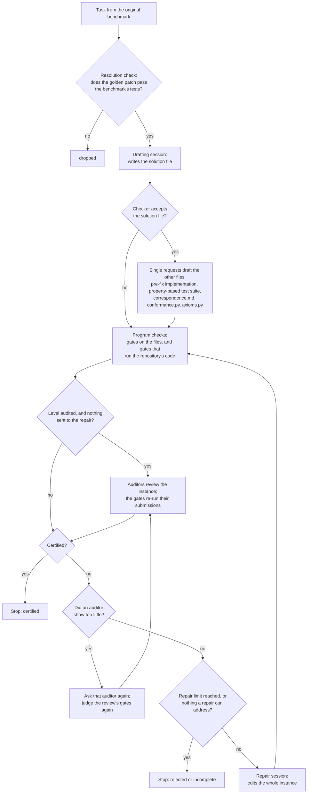

# How Benchproofer works

This page follows one task from the original benchmark to a verified instance: a formal specification, a formal implementation, the axioms they rest on and the proofs, together with the evidence that lets anyone re-check them. It covers every backend. The details are in [Gates](gates.md), [Backends](backends.md) and the [CLI reference](cli.md).

## What goes in and what comes out

A task from the original benchmark comes with an issue statement, a repository at a commit, the *golden patch* (the benchmark's own fix) and the *test patch* (the benchmark's change to the tests). The code with the golden patch applied is the *fixed code*. The task names two lists of tests: the FAIL_TO_PASS tests fail before the fix and pass after it, and the PASS_TO_PASS tests pass both before and after.

What comes out is an *instance* (in the code and on disk it is called a *bundle*). Its main file is the *solution file*, which holds three parts, each between marker comments so that a program can take one out or swap one in:

- the *specification*: a formal statement of what the changed code must do. Its *preconditions* say which inputs the code must handle, and its *postconditions* say what the code must return or do for them;
- the *reference implementation*: the fixed code, written in the language of the *checker*, the program that decides whether an implementation meets a specification;
- the *proof* that the reference implementation meets the specification on every input the preconditions admit.

A function the golden patch calls but does not change, an *unchanged callee*, is not formalized by an implementation in the checker's language. The specification summarizes it with an *axiom*: a declaration the checker takes as true without proof. Axioms go in a region of their own, so that what is assumed is kept apart from what is proved.

Around the solution file the instance keeps the files that let users inspect and re-check it, the evidence each check wrote, and one *verdict* per *gate*. A gate is a program that decides one property of the instance and records a verdict: pass, fail, error, timeout, or undecided with a reason. No language model decides a verdict. Where a language model takes part, as an auditor (below), the gate re-runs what the auditor handed in and decides from that.

From its verdicts an instance gets one of four outcomes. It is `certified`, a verified instance, when every gate its level requires passed, and `rejected` when one of them failed. It is `incomplete` when one is missing, undecided, or *stale* (reached from files that have changed since). It is `dropped` when the task itself is unusable, because the golden patch does not pass the benchmark's tests. A run asks for one of three levels, `static`, `oracle` or `audited`, and each requires everything the one below it requires ([Levels](concepts.md#levels)).

## The loop at a glance

When the checker refuses the solution file, the program checks still run before the repair: on an instance with files missing they take little time, and they hand the repair every finding at once (the checker's refusal, hygiene and leakage findings, and each missing file) instead of the refusal alone.

Each pass of this loop is a *round*. Benchproofer keeps a copy of the instance after each round, with a `round.md` that lists every finding of each gate that did not pass. These copies are under the cache directory, and later repair sessions and auditors read them. The repair loop runs at every level: at `static` and `oracle` it repairs what the program checks found, and only `audited` adds the review.

## The loop, step by step

### 1. The resolution check

At level `oracle` and above, the golden patch is applied to the repository and the benchmark's tests are run before anything is drafted (`oracle.reference_resolves`). The run is tried up to three times. A task whose golden patch fails them is `dropped`: nothing is drafted, reviewed or repaired for it, and the report lists it apart from `rejected`. The check runs once per task: a pass or a failure recorded from the same task, golden patch and gate code is reused in later rounds, and only an error or a timeout is run again. At level `static` this check does not run.

### 2. Drafting

The solution file is written by a *session*: a Claude Code agent that reads files, runs commands and edits files in a workspace of its own until it is done or its time runs out. Every other file is a *single request*: one prompt and one reply, asked a second time if the reply cannot be used.

**The solution file (a session).** The session's workspace holds a template solution file that shows the checker's file shape; the task (its statement, the golden patch, and the names of both lists of tests); a copy of the repository at the task's commit with the test patch applied, and the files the fix touches as they read after the fix; and a `./tools` command that runs the checker the way the gates do (`./tools verify`) and runs a Python program against the fixed code (`./tools run`). Before it writes anything, the session is asked to read the statement, the golden patch, the FAIL_TO_PASS tests and the PASS_TO_PASS tests the test patch adds or edits (in full), the PASS_TO_PASS tests that call a function the fix changes, and the changed functions with their *callees* (the functions they call) and the state they read. It derives the specification from these alone. It runs the checker after each edit, until the checker accepts the file or its time runs out. It may write only the solution file and its own scratch directory. It reports `VERIFIED` or `BLOCKED`, which repository functions it modeled, how it stated each unchanged callee (modeled or by an axiom: drafting never takes a callee's result as an input, which only a repair may do, for a callee this run's rounds list; see step 5), and what it left out. Only the solution file is taken from the session, and Benchproofer runs the checker on it again.

**Proof sessions.** Some provers check a proof written in the file itself: Nagini, Lean 4, Velvet and Dafny. When the checker of one of these refuses the drafted file, a *proof session* gets the file with its specification and implementation held fixed and writes only the proof: loop invariants, assertions, lemmas or tactics. The session can write the whole solution file, so it could also make the proof go through the wrong way: by weakening the specification (a postcondition dropped or loosened, a precondition tightened), by changing the implementation, or by assuming what it should prove. Benchproofer therefore keeps its file only if the specification is exactly as drafted, the implementation differs only by proof annotations, it uses no forbidden construct, the checker accepts it, and, under Lean 4, the proof rests on no axiom beyond Lean's own and the instance's declared ones.

**If the checker still refuses the solution file**, nothing else is drafted. The gates then fail (the verification check, and every check whose file is missing), and the first repair session writes the solution file again together with every missing file.

**The other files (single requests).** Each is drafted against the solution file the checker accepted:

- **The pre-fix implementation** (`twins/`): the code before the fix, written in the checker's language under the same specification. The specification must reject it. It is drafted only when the repository had code before the fix.
- **The property-based test suite** (`rivals/`): implementations written against the specification, each labeled with the verdict it should get. It checks the same property the attack auditor (step 4) checks, that the specification rejects wrong implementations and accepts correct ones, but it is written, sized and judged differently ([Appendix: the property-based test suite and the attack auditor](#appendix-the-property-based-test-suite-and-the-attack-auditor)). Each one is a *rival*, drafted in a request of its own and shown the rivals of its kind drafted before it; a rival that repeats another file is dropped. The suite holds:
  - two uniqueness rivals: wrong implementations the specification must reject. They are shown the pre-fix implementation;
  - one soundness rival: a correct implementation, written differently, that the specification must accept;
  - under a prover, one or two admissibility cases, called *probes*. A probe calls what the specification declares at one concrete input and asserts the expected result; it must be accepted, which shows the preconditions admit that input. The first probe uses an input of the shape the FAIL_TO_PASS tests use. A second is drafted where a PASS_TO_PASS test the test patch adds or edits exists, or another PASS_TO_PASS test whose own code calls a changed function by name; it is shown those tests whole and takes its input from them.
- **`correspondence.md`**: how each operation of the implementation corresponds to the golden patch's, in four sections: `Symbols`, `Operations`, `Not modeled` and `Outside the bridge`. The *type bridge* is how each of the specification's types maps onto the repository's values. `Outside the bridge` names inputs on which the implementation is not compared with the fixed code, each with its reason, and only of three kinds: a value the specification's types admit that the repository never has there; two repository values the type bridge reads as one, where no test and nothing in the issue tells them apart and the golden patch returns on both or raises on both; or an input on which the fixed code runs only lines the golden patch left as they were. `conformance.py` may skip such an input by citing its entry, and the equivalence auditor checks each entry. A repair that takes a callee's result as an input (step 5) adds a fifth, `Callee results taken as inputs`, with each such callee's call site and reason, and the model states each such call's arguments as an output; the run report lists each entry under the same heading. The draft starts from what the drafting session reported.
- **`conformance.py`**: a Python program that runs where the benchmark's tests run. It draws inputs, calls the implementation (or a Python copy of it) and the fixed code on each, and prints a line for every input where the two disagree. It is run once, as the gate will run it, and drafted again once in the same conversation if that run established nothing: it crashed, its time limit cut it short, it compared nothing (every input it drew was skipped or failed before both sides ran), it compared with a name no module it imports defines, it printed a line no reader parses, or it skipped a function (it is then asked for a way to reach it). A disagreement is never sent back: it is the comparison working, and for the gate to weigh ([Appendix: why a disagreement is not sent back](#appendix-why-a-disagreement-is-not-sent-back)). It is not drafted for a task that ships no reference solution at all (no golden patch, reference files or answer), such as a task file of your own that gives only the problem and its tests, since there is no fixed code to compare with.
- **`axioms.py`**: drafted only when the specification has axioms. It runs each axiom's claim against the real callee at the task's commit. This is the drafter testing its own axioms; the fuzz auditor (below) tests them independently.

Under Lean 4 and Velvet, the pre-fix implementation and each rival the specification must reject also carry a *refutation witness*: a claim, proved at one concrete input, that the file's result there breaks the specification. In these provers a proof is written for the reference implementation's exact form, so a rival's proof can fail to build even where the rival meets the specification; the witness shows the rejection comes from the specification. A correct rival the checker refuses, and a witness the checker refuses, each get a proof session. What drafting did is written to `notes.md`, the drafting log.

### 3. The program checks

These gates are programs, and anyone can run them again on the instance. They come in two groups ([Gates](gates.md)).

**Checks on the files** ([static gates](gates.md#static-gates)), decided from the instance and the checker:

- `artifact.integrity`: every file is present and readable, its digest is the one recorded, the frozen task is unchanged, and the suite names only files the instance ships.
- `spec.hygiene`: the marker regions are present and the specification is more than a few tokens long. The file has no construct that switches the checker off or assumes what it should prove, keeps assumptions in the axioms region, imports only what the backend allows, claims termination where the backend can check it, and obeys the backend's own rules.
- `spec.no_leakage` (leakage screen): the *spec view*, which is what a solver is shown (the specification with the implementation and proof removed), may not reproduce the golden patch or the test patch: no changed line, no path or name of what the patch touches, no identifier built from such a name, and no words such as *bug* or *fix*, unless the statement already says it. This is a text check; the disclosure auditor (below) reads the spec view for what a text check cannot see.
- `spec.verifies`: the checker accepts the solution file. Under Lean 4 the proof may also rest only on Lean's standard axioms and the instance's declared ones. A checker that gives no verdict leaves this undecided.
- `spec.discriminates`: the checker rejects the pre-fix implementation, with a refutation witness under Lean 4 and Velvet. An instance with no pre-fix implementation, where the task had code before the fix, fails here, and the repair writes it.
- `spec.strength.mutation`: up to 16 small changes are made to the implementation (a comparison, arithmetic or boolean operator swapped, a constant moved by one). Each mutant the checker accepts must be shown to compute what the reference implementation computes, or the specification is too weak.
- `spec.strength.battery` (property-based falsification): each rival gets the verdict its label claims. The rivals come from drafting (step 2) or a repair; the gate itself only runs the checker on them. A wrong rival the checker accepts shows the specification too weak, and a correct rival or probe it refuses shows it too strong. A rival is *unproved* when it is correct but the checker rejected a step of its own proof; that is the rival's or the checker's fault, not the specification's, and the run report lists every unproved rival. An instance with no suite, with a required kind of rival missing, or without a rival the last verdict judged and did not find defective fails this gate, and the repair writes the missing rival.

**Checks that run the repository's code** ([oracle gates](gates.md#oracle-gates)), at level `oracle` and above:

- `impl.conformance`: tests, by running, that the reference implementation computes what the fixed code computes: `conformance.py` calls both on the same drawn inputs and compares the results. The proof shows the implementation meets the specification; this gate shows the implementation behaves like the repository, so the specification is tied to the real code and not only to a model of it. (The equivalence auditor checks the same correspondence by reading the two, so it also covers inputs no run drew.) Every input on which an earlier run found a disagreement, and the input of every defect the attack auditor filed (step 4), is kept in the instance's evidence and compared first, so a later precondition cannot quietly shut it out. A disagreement fails the gate. A run that compared nothing, or whose output cannot be read, leaves it undecided. A pass is run again on the code before the fix; if it agrees there too, that is noted for the equivalence auditor, since a comparison that cannot tell the fixed code from the old code shows little. The verdict records whether the implementation itself ran or a Python copy of it, and how many inputs were compared. The target is 100,000 inputs; a shortfall is recorded, not penalized. An instance without `conformance.py`, where the task has a golden patch, fails, and so does a `conformance.py` that skips an input on record as outside the preconditions without citing an `Outside the bridge` entry (a defect's input, which no run drew, may be declared outside them without one).
- `spec.axioms_grounded`: `axioms.py` runs against the repository at the task's commit (with the golden patch applied for a callee in a file the patch changes). It must find each axiom true of its callee, and call each one. An instance whose specification has axioms but no `axioms.py` fails, whether or not the solution file verifies.
- `oracle.reference_resolves`: the resolution check of step 1, reused.

### 4. The review by adversarial auditors

At level `audited`, an instance is reviewed once no program check sends it to the repair and nothing holds the review back (a checker or test environment that is not installed holds it back, since the review needs them too).

An *auditor* is a Claude Code session on a language model other than the one that drafted the instance. An auditor is not a gate: it hands in submissions and judgments, and the gates that read the review ([audited gates](gates.md#audited-gates), below) decide from them, re-running every submission that can be run. There are six auditors. Five run one after another in this order: attack, fuzz, faithfulness, equivalence and disclosure. The first two hand in files; the next three are the *judging auditors*, which hand in a verdict (`sound`, `unsound` or `uncertain`) with findings. The sixth, the attack validation auditor, runs last, once the gates have re-run the review's submissions, and only when an attack or a control among them cannot be determined by execution; it hands in rulings. Each but the disclosure auditor works in its own copy of the instance, with the repository at the task's commit, the test patch (not applied) and `./tools`; with `./tools try` and `./tools fuzz` an auditor can judge a submission exactly as the gates will before it hands it in.

#### The attack auditor

It is asked for at least five *attacks* and three *controls*, each with a sentence saying what it shows. It checks the same property as the property-based test suite drafted in step 2, as an independent adversary rather than the drafter testing its own specification ([Appendix: the property-based test suite and the attack auditor](#appendix-the-property-based-test-suite-and-the-attack-auditor)).

- An **attack** is an implementation the auditor believes is wrong and the specification may accept: it tries to show the specification is too weak. Each attack comes with its *equivalent patch*: the same wrong change written as a patch to the repository, so the benchmark's tests can judge it.
- A **control** is a correct implementation, written differently from the reference implementation: it tries to show the specification is too strong.
- A **defect** is an input the specification admits on which it promises what the repository does not do, which the auditor showed by running code and no attack of its shows. It names a function `conformance.py` compares and the arguments to call it with; a defect without both is not filed. Its input joins those `conformance.py` compares first on every run, so a disagreement there fails `impl.conformance`, judged again in the same round. Defects stay on record until the specification they were shown against changes.

An attack *succeeds* when it shows a real weakness: the checker accepts it and its implementation is really wrong. It *fails* when the checker rejects it, or when its implementation turns out to be correct after all. The gates decide which by re-running each attack: the checker first, then a comparison with the reference implementation, then `conformance.py` with the attack's code in place, then its equivalent patch under the benchmark's tests. An attack whose patch the tests pass may come with a *witness test*: a Python program the gates run on the fixed code, where it must pass, and with the attack's patch in place of the golden patch, where it must fail, citing the statement sentence or the test it checks; when it does, the attack validation auditor rules whether what it cites asks for the behavior it checks, and the attack succeeds where it does. One that fails on the fixed code, passes with the patch, or cites nothing is evidence of nothing. A control is judged by `conformance.py` with its code in place. Under Lean 4 and Velvet a control the checker refuses may come with a refutation witness, a claim proved at one input that the specification refuses what the control returns there, and a run showing the fixed code returns the same; then the specification is too strong. An attack or a control that cannot be determined by execution goes to the attack validation auditor. The steps are in [Appendix: how the gates decide an attack or a control](#appendix-how-the-gates-decide-an-attack-or-a-control).

After a repair changes the specification, the attack auditor is asked again. Its earlier submissions are not run again; it is shown each earlier attack with what the gates ruled and what the repair said about it, and it first rewrites, against the specification as it now stands, each attack that succeeded.

#### The fuzz auditor

It writes one *fuzzer* for each unchanged callee not yet attacked: a Python program that calls the real callee on many inputs and prints a line for each input where an axiom about it is false. Where `axioms.py` is the drafter checking its own axioms, the fuzzers are an independent attempt to refute them.

#### The faithfulness auditor

It judges coverage only, as the SWE-Proof paper means faithfulness: whether the specification describes this task, with nothing the task requires left out and nothing it never asked for demanded. A change the issue statement asks for must be in the specification even when no test checks it. It hands in a verdict, its findings, what it ran, and a coverage table: for each behavior the FAIL_TO_PASS tests and the PASS_TO_PASS tests the test patch adds or edits check, the test that checks it and the part of the specification that states it. It is shown earlier findings with what each repair said about them. Whether the specification demands what the fixed code does not do is not its question: the attack auditor's controls and defects show that, and the attack validation auditor rules on the controls that cannot be determined by execution.

#### The equivalence auditor

It judges whether the implementation does what the golden patch does, by reading the two operation by operation; it is not asked for a task with no golden patch. It hands in a verdict and a table of the golden patch's operations, each with a kind: `identical` (the same concrete operation), `refinement` (the same operation over a more precise type, or state the code reads taken as a parameter, or a part of a result, or the result of a call of a callee this run's rounds list, taken as an input, with `correspondence.md` saying how it maps), `modeled` or `axiom` (a call of an unchanged callee, computed by a definition or assumed by an axiom), `unchanged`, `unbridged` (the same on every input the type bridge covers, differing only on inputs listed under `Outside the bridge`), or `changed`, which makes the verdict `unsound`. It also checks that every axiom represents a callee the golden patch does not change, and every `Outside the bridge` entry; that every callee's result the model takes as an input is the result of a callee this run's rounds list (step 5) and meets the four conditions of the rule for doing so: an unchanged callee, never code inside a changed function (a branch or guard included) nor a call whose arguments the golden patch adds, changes or computes; a reason that holds; a domain that admits the real callee's results, which `conformance.py` hands the implementation, one input per call; and the call itself stated where a FAIL_TO_PASS test, or a PASS_TO_PASS test the test patch adds or edits, checks it (the faithfulness auditor is shown the same list and rule; with no callee listed, neither is, and a parameter holding a callee's result is `changed`); that the repository side of `conformance.py` calls the repository's code for each function the golden patch changes that the specification models, rather than a copy of it or a comparison that would agree with the code before the fix on what the fix changes (it is shown the note `impl.conformance` records when `conformance.py` agrees with the code before the fix too); under Lean 4 and Velvet, that the Python copy of the implementation in `conformance.py` follows the implementation line by line; and that a repair's changes to `conformance.py` and `axioms.py` do not make them compare less. Where `impl.conformance` compares outputs on the inputs it draws, this auditor reads the code, so it also covers inputs no run drew.

#### The disclosure auditor

It reads only the spec view, the statement and the code before the fix, with tools that cannot run anything or write files, and judges whether a solver could copy the specification's steps into code. Each finding quotes the line it rests on and says what kind it is: `loop`, `intermediate`, `table` or `literal` (the specification spells out the computation), or `oracle` (a postcondition that reads the result from a term the specification itself defines instead of deriving it from the inputs). Where `spec.no_leakage` looks for the golden patch's text, this auditor looks for a specification that gives the implementation away.

#### The attack validation auditor

Every attack and control is run first: through the checker, through `conformance.py`, and for an attack its equivalent patch through the benchmark's tests. An attack or a control cannot be determined by execution when the runs cannot tell right from wrong, or contradict each other, so what remains is a question about the task or about a proof rather than one a run can decide (step 6 in [Appendix: how the gates decide an attack or a control](#appendix-how-the-gates-decide-an-attack-or-a-control)). It rules on four kinds:

- an attack whose patch the benchmark's tests pass and that nothing showed equal to the reference implementation, since a Lean 4 or Velvet attack cannot run in Python and under Nagini `conformance.py` could not run it or saw no difference: does the behavior it changes belong to what the task requires, because the statement asks for it or a FAIL_TO_PASS test or a test the test patch adds or edits checks it? If so the attack succeeds; otherwise it fails;
- such an attack whose witness test passes on the fixed code and fails with its patch: does what the test cites ask for the behavior the test checks, a value returned, an exception raised or an effect on state? A sentence asks only for what it states, and one naming a quality goal (performance or overhead, compatibility, robustness, clean code) asks for no behavior; a test id asks for what that test asserts, on its inputs or on others of the same kind. If it does the attack succeeds; otherwise it fails;
- an attack shown equal to the reference implementation whose patch the tests reject, where two runs contradict each other: is the model at fault, so that the specification accepts what the tests reject (the attack succeeds), or the patch (it fails)?
- a control the checker refuses that nothing showed correct or wrong, since a refusal does not say whether the specification rules it out or a proof step is missing: is it correct and refused by the specification (the specification is too strong), correct and refused for a proof it lacks (listed as unproved in the run report), or not correct (set aside)?

It is a session of its own, separate from the attack auditor, whose job is to break the specification: ruling on its own attacks, that auditor could reject an instance on its own word, which verified-swebench allows only with an executed result. It runs on the reviewing language model, with the other auditors' time limit. It works in a copy of the instance with the submissions and the gates' rulings on them, the faithfulness auditor's coverage table, the statement, the golden patch, the test patch and the repository. A ruling counts only when it names the input and the statement sentence, test or obligation it rests on (for a witness test, the input the test runs with the behavior it checks there, and what the test cites), and only while the specification (axioms included), the implementation, the submission's files and what its witness test cites are as they were when it ruled. It is asked again about an attack or a control it left without a ruling; one still without a ruling is discarded and counts neither way.

#### The gates that read the review

Each reads the work of an auditor and re-runs what can be run:

| gate | reads | decides |
| --- | --- | --- |
| `audit.independence` | the review record: which language model ran the auditors | passes when it differs from the drafting one |
| `audit.spec_completeness` | the attack auditor's attacks and witness tests, and the attack validation auditor's rulings on those that cannot be determined by execution, among them an attack whose witness test passes on the fixed code and fails with its patch | fails on an attack that succeeded; needs at least five attacks decided; undecided while an attack that cannot be determined by execution has no ruling that counts |
| `audit.spec_soundness` | the attack auditor's controls and refutation witnesses, and the attack validation auditor's rulings on those that cannot be determined by execution | fails on a correct control the specification refuses, shown by the gates, by a proved refutation witness with its run, or by a ruling; needs at least one control accepted and shown correct |
| `audit.axiom_soundness` | the fuzz auditor's fuzzers | runs them again: an input on which an axiom is false fails the gate, and a callee no fuzzer tried leaves it undecided |
| `audit.faithfulness` | the faithfulness auditor's judgment | reports its verdict |
| `audit.equivalence` | the equivalence auditor's judgment | reports its verdict; also fails a reviewed instance with no `correspondence.md` |
| `audit.no_disclosure` | the disclosure auditor's judgment | reports its verdict |

For the last three, `unsound` fails and `uncertain` is undecided. Each judgment records digests of the files it was reached from; once one changes, the verdict is stale ([Judgments expire](gates.md#judgments-expire)).

### 5. The repair session

A repair is a Claude Code session given the instance's findings to address. Its workspace holds a copy of the instance, this run's earlier rounds, each auditor's scratch files, the repository at the task's commit with the test patch applied, `./tools`, and a `./check` command that runs the program checks of level `oracle` on the edited copy as the loop will. Its brief, also written to `brief.md`, lists the findings, numbered in gate order, each with its gate's title; the attacks with their files, claims and rulings; earlier repairs whose edits were not taken, with their diffs; what each earlier round found and what the repair after it did; the rules for every file the instance lacks or the findings name; and its time limit. Where an unchanged callee's definition or axiom, written as the rule for callees asks, failed in two rounds with a repair between them (the axiom-soundness gate refuted it, or the checker reported an error on a line of its declaration), the brief lists that callee with those rounds and the lines the fuzzer or the checker printed about it, and the rule for taking its result as an input of the model. Benchproofer's code decides the list from the rounds' records (`core/rounds.py`); a brief that lists no callee states the rule for callees alone, as drafting does.

The session may change the solution file, the pre-fix implementation, the rivals, `correspondence.md`, `conformance.py` and `axioms.py`, and nothing else. It leaves the whole instance: it writes any of these files that is missing, keeps the copies of the implementation in `conformance.py` and of the axioms declarations in `axioms.py` in step with the solution file, and may remove a case of the property-based test suite only where `spec.strength.battery` found it defective. Its brief carries the rules of each file the instance lacks or the findings name, and says which files are missing. For each finding it reports whether it resolved it, found it not a defect, or did not reach it, with a witness: the input, the wrong implementation or the quoted line the repair addresses. The auditors who judge it next are shown that text whole.

Afterwards Benchproofer only checks the result, with programs and no language model: a session whose solution file cannot be read, or that changed nothing, is not taken; everything else the session left is kept as it left it, and the next round's gates judge it. No checker runs, nothing is put back and nothing is drafted after the session; evidence its changes made obsolete is removed. A repair is never thrown away for what it changed: a precondition that shuts out an input the specification has to admit is caught by `impl.conformance` (for every input on record) and by the next review, which holds every added precondition and `Outside the bridge` entry to the rule below. To *narrow* is to shut out, by a precondition, an `Outside the bridge` entry or a skip in `conformance.py`, an input the specification admitted before, or one it has to admit: an input on which a changed function returns normally and which the benchmark's tests or the statement hand to it. The repair is recorded in `manifest.json` (`provenance.repairs`).

Then the loop goes back to the program checks. A repair that changed nothing still uses up one repair, and the next round repairs again without judging the same instance a second time.

### 6. When an auditor is asked again

After a repair, a review asks only the auditors whose work is out of date: every auditor at the first review; the attack auditor when the specification or the task has changed since its submissions; the fuzz auditor when an unchanged callee has no fuzzer written against the current axioms; a judging auditor when its judgment is missing or stale. The others' work stands.

Between rounds, an auditor is also asked again about the unchanged instance, before anything is repaired, when it showed too little: the completeness gate had fewer than five attacks decided, or the soundness gate had no control accepted and shown correct; one of the two lists attacks or controls that cannot be determined by execution and that the attack validation auditor has not ruled on; or a judgment is stale. This is decided by Benchproofer's code from the gates' verdicts (`pipeline/route.py`), not by a session. The auditor gets a new session, not the old one resumed, and its prompt shows its earlier findings, and the attack validation auditor is shown the attacks and controls its gates list. Asking again spends no repair, so it happens even once the repair limit is reached; the round that asks judges only the review's gates, with `impl.conformance` when the review filed a defect. The attack validation auditor is first asked within the review that filed what it rules on, so it is asked once more at most; an attack or a control it then leaves without a ruling is discarded. Each question is asked once per state of the instance: if the same auditor falls short again on the same instance, it is not asked a third time, and a repair runs if anything else needs one.

### 7. When the loop stops

After each round, every verdict that is not a pass goes one of four ways ([Where a verdict goes](gates.md#where-a-verdict-goes)):

| verdict | where it goes |
| --- | --- |
| a failure, including a file of the instance a gate needs and does not find; an error or timeout of the checker or a program on the instance's files; undecided for a reason a repair can address | to the repair |
| undecided because an auditor showed too little, or an attack or a control that cannot be determined by execution has no ruling | that auditor, or the attack validation auditor, is asked again |
| the checker or the benchmark's test environment is not installed | it holds the review back; no repair addresses it |
| a crash of Benchproofer's own; no instance or no review to read; a failure, error, timeout or undecided verdict of the resolution check | nowhere: no repair or auditor is sent for it |

The loop ends when the instance is certified or the task is dropped; when nothing goes to the repair and no auditor is to be asked again; when the repair limit is reached (`max_repairs`, five by default); or when a language model or a session could not be reached at all, which ends the task with an error and keeps the instance as the last round judged it.

## Backends

**What every backend shares.** The loop, the gates, the auditors, the route table, the instance's layout and the resolution check are the same for every backend, and so are `conformance.py` and `axioms.py`, which are always Python because they run where the benchmark's tests run. A backend supplies the checker and how to call it, the file shape, the constructs it forbids, where assumptions may go, how a probe and a refutation witness are written, and the guidance its sessions are given. Benchproofer's runs use Nagini, Lean 4 and Velvet.

### Nagini

- **Checker.** [Nagini](backends.md#nagini), a prover for Python built on Viper. It adds about 20 seconds of startup to each call.
- **The file.** The contracts `Requires(...)` and `Ensures(...)` on the function's definition line are the specification, and the body is the implementation. The function claims termination with `Requires(MustTerminate(...))`, and each loop with `Invariant(MustTerminate(...))`. The proof is annotations in the body: `Invariant`, `Assert`, `Fold` and `Unfold`. An unchanged callee is a `@ContractOnly` function in the axioms region. `Assume(` and `Refute(` are forbidden, and imports are limited to `typing` and `nagini_contracts`.
- **Comparison with the repository.** The implementation is Python, so `conformance.py` contains the body itself, with the annotations stripped, and calls it next to the fixed code. A body that uses Nagini's own types (`PSeq`, `PSet`, `PMap`, `ToSeq`) needs a Python translation instead, and the verdict says so. An accepted attack can be executed next to the reference implementation on the same drawn inputs.
- **Probe and witness.** A probe is a top-level function after the implementation that calls it at one input and asserts the result. No refutation witness is required: Nagini proves postconditions itself and names the one a rejected implementation fails to establish. A rival with a loop can still be rejected for a loop invariant that is too weak, which no witness separates from a real rejection.
- **Proof sessions** close each obligation with a loop invariant, an assertion of the fact the next step needs, or folding and unfolding a predicate, at the line Nagini's error names.

### Lean 4

- **Checker.** [Lean 4](backends.md#lean4), a prover. It runs as the plain `lean` executable, or inside a Lake workspace named by `BENCHPROOFER_LEAN_WORKSPACE`, where Mathlib can be imported.
- **The file.** The specification is a predicate over the inputs and the result, the implementation a `def` (with any helper definitions it needs), and the proof a `theorem` that the implementation meets the specification for every input; the hygiene check requires that theorem to name both. `axiom` and `opaque` may appear only in the axioms region. `sorry`, `admit`, `native_decide`, `partial def`, `unsafe`, `implemented_by`, `extern`, `maxHeartbeats 0` and loops that need not terminate are forbidden. The verification check also prints the axioms the theorem rests on (`#print axioms`): only `propext`, `Classical.choice`, `Quot.sound` and the instance's declared axioms may appear.
- **Comparison with the repository.** Lean code cannot run where the benchmark's tests run, so `conformance.py` holds a line-by-line Python copy of the Lean implementation and compares that copy with the fixed code. The verdict records it as a translation, and the equivalence auditor checks that the copy follows the Lean code. An accepted attack fails, its implementation shown correct, where a proof shows it computes what the reference implementation computes; otherwise its equivalent patch decides it.
- **Probe and witness.** A probe is an `example` in the implementation region. A refutation witness is a claim such as `example : ¬ spec (impl x) x := by decide` at one input.
- **Proof sessions** follow a Lean playbook: how loops written with `for` and `let mut` unfold, and which tactics usually close the goals that remain.

### Velvet

- **Checker.** [Velvet](backends.md#velvet), a program verifier inside Lean 4 whose goals the Loom framework discharges. It runs in a pinned Lake workspace (`BENCHPROOFER_VELVET`) and adds about 60 seconds of startup to each call.
- **The file.** A `method` with `require` and `ensures` clauses is the specification, its `do` block the implementation, and `prove_correct … by loom_solve` the proof. The file must ask for total correctness (a method that never returns does not meet its postcondition) and demonic choice (every run must be good, not just one). Besides Lean's forbidden constructs, `trust_smt`, `loom_solve_async`, partial correctness and angelic choice are forbidden. Imports are limited to Velvet, Mathlib, Std, Batteries and Init. The hygiene check refuses a result of type `Float`, `Real` or `Rat`, since no refutation witness can be decided over it. There is no `#print axioms` check.
- **Comparison with the repository.** As for Lean 4: a Python copy of the implementation in `conformance.py`, checked by the equivalence auditor, and accepted attacks decided by a proof or by their equivalent patch.
- **Probe and witness.** A probe is a `have` at the start of the method's body that restates a clause of the specification at one input. A refutation witness is a claim, over the tester Velvet derives for the method, that the tester returns `false` at one input.
- **Proof sessions** work with `invariant`, `decreasing` and `done_with` annotations.

### The other backends (not tested; contributions welcome)

These backends ship with Benchproofer but have not been tested in its runs on repository tasks. Contributions that test, fix or extend them are welcome.

- **`dafny`** is a prover: the Dafny verifier, with proofs written in the file. `assume`, `{:verify false}` and `{:only}` are forbidden, and `{:axiom}` and `{:extern}` may appear only in the axioms region. It is meant for small pure functions, such as the tasks of HumanEval, MBPP and QuixBugs.
- **`smt`** is a prover: Z3 over SMT-LIB2. The file asserts the negation of what it must show, and `unsat` means verified. It is meant for arithmetic word problems such as GSM8K.
- **`crosshair`** searches for counterexamples by symbolic execution of Python functions with contracts in their docstrings (PEP 316). It proves nothing: acceptance means no counterexample was found.
- **`falsifier`** searches for counterexamples with Hypothesis, a property-based testing library. It proves nothing either. It needs nothing installed beyond Benchproofer's own dependencies, so a fresh install can run the whole loop with it. Under it and `crosshair` there are no probes, no proof sessions, and no proof that two implementations compute the same thing ([Provers and falsifiers are not interchangeable](backends.md#provers-and-falsifiers-are-not-interchangeable)).

Every backend that is not Python goes through a Python copy of its implementation in `conformance.py`. Repository tasks assume a Python repository: `conformance.py`, `axioms.py` and the fuzzers are Python programs, the benchmark's tests run under pytest, and the changed functions are found by reading Python. Which backend suits which benchmark is in [Choosing a backend for a benchmark](backends.md#choosing-a-backend-for-a-benchmark).

## What a session may read and write, and how long it has

Sessions are Claude Code with its file tools (Read, Grep, Glob, Bash, Write, Edit) and no web access. The disclosure auditor gets only Read, Grep and Glob. Each session starts in a workspace of its own.

- **Allow-list.** A session may read its workspace, the toolchains (the Python environment, the checker's installation, the Lean toolchains and Lake workspaces), what Claude Code saved of this conversation, and the system directories (`/usr`, `/lib`, `/bin`, `/etc`, `/proc`, `/dev`). Refused are Benchproofer's own package, other processes' entries under `/proc`, `cd` to the home directory, and `locate`. This check reads the text of each tool call; it is not a sandbox, so the prompts also tell every session not to read Benchproofer's source or other runs.
- **Write guard.** File tools write only where the stage allows, plus the session's scratch and temporary directories: a drafting or proof session its solution file, a repair its copy of the instance, an auditor only its scratch directory, from which its submissions are read.
- **Environment.** `PYTHONPATH` and Benchproofer's own settings are cleared from the session's environment. The `./tools` and `./check` commands read their settings from a file the session cannot read, and they can reach no language model.
- **Time limits.**

| what | limit |
| --- | --- |
| the drafting session | 3,600 s and 200 turns |
| a proof session | 3,600 s and 200 turns |
| a repair session | 9,000 s and 200 turns |
| each auditor's session | 10,800 s and 200 turns |
| one call of the checker | 300 s, plus the backend's startup |
| one run of the benchmark's tests | 3,600 s (the resolution check tries up to three times) |
| one run of `conformance.py` or `axioms.py` | 1,800 s; `conformance.py` draws inputs for two thirds of it |
| one shell command in a session | the smaller of the session's limit and 3,600 s |
| repair sessions per task | 5 (`max_repairs`) |

Every limit is a setting ([Settings](cli.md#settings), [Agent sessions](cli.md#agent-sessions)). A session stopped at its limit, or one that stops without reporting, is taken up once more for a few turns and asked for its report; what it wrote by then is checked as any session's work is.

## Reading an instance

**What the outcome tells you.**

- **`certified` at `static`**: the checker accepts the solution file. The specification rejects the pre-fix implementation (where there is one), and no mutant or rival shows it too weak or too strong. The spec view does not reproduce the golden patch. Nothing has compared the implementation with the repository.
- **`certified` at `oracle`**: in addition, the implementation agreed with the fixed code on every input `conformance.py` drew, each axiom held of its real callee on the inputs `axioms.py` tried, and the golden patch passes the benchmark's tests.
- **`certified` at `audited`**: in addition, an auditor on another language model could not get a wrong implementation past the specification in at least five decided attacks; the specification accepts a correct implementation written differently; the faithfulness, equivalence and disclosure judgments are favorable and about the files the instance ships now; and no fuzzer found an axiom false.
- **`rejected`**: a required gate found something. Its summary says what, and its details name the input, the file or the line.
- **`incomplete`**: no required gate failed, but at least one is missing, undecided or stale: a checker that is not installed, a review that did not run, or a run that reached its repair limit while a gate was still undecided. The instance may be sound, but nothing decided it.
- **`dropped`**: the golden patch does not pass the benchmark's tests, so the task cannot judge a formalization. This is not a failed formalization.

The faithfulness, equivalence and disclosure verdicts, and the attack validation auditor's rulings, are a language model's judgment; the gates check only that each is filed, current and consistent with what the programs found. `conformance.py` compares on the inputs it draws, not on every input. [What certification does not claim](concepts.md#what-certification-does-not-claim) lists the limits.

**Where to look.**

| to see | look in |
| --- | --- |
| each gate's status, summary and details | `manifest.json`, under `verdicts` |
| who drafted, reviewed and repaired it, and what each repair did | `manifest.json`, under `provenance` (`provenance.repairs` for the repairs) |
| what a gate ran and printed | `evidence/` |
| the specification, implementation and proof | `solution.*` |
| the pre-fix implementation and its witness | `twins/` and `twins/index.toml` |
| each rival, the verdict it claims and why | `rivals/` and `rivals/index.toml` |
| how the implementation corresponds to the golden patch | `correspondence.md` |
| the review: submissions, fuzzers, judgments, the attack validation auditor's rulings, coverage and operation tables, and the digests each judgment was reached from | `audit/index.toml` and the files beside it |
| what drafting did | `notes.md` |
| each round of the last run, with every finding | `rounds/` under the instance's directory in the cache, each with a `round.md` |

To judge an instance again without any language model, run `benchproofer check` with the level you want (`benchproofer check my-suite --level audited`). To summarize many instances, run `benchproofer report`. Both classify verdicts the same way.

## Appendix: why a disagreement is not sent back

While drafting, `conformance.py` is run once and sent back to the request that wrote it when the run established nothing (step 2). A disagreement with the fixed code is not among the reasons, on purpose.

A disagreement is the comparison doing its job: on some input the implementation in the solution file and the fixed code give different results, so the specification or the implementation is wrong there. The request that wrote `conformance.py` can change only `conformance.py`, so every way it has to make the disagreement go away changes the measurement instead of the specification: it can stop drawing that input, catch the exception the fixed code raises, compare less of the result, or skip the function. Each of these turns a finding into a pass.

For example, suppose the specification promises a value on an input where the fixed code raises an exception. The implementation, which meets the specification, returns a value there, so `conformance.py` reports a disagreement. Sent back, the request would most easily stop drawing such inputs, and the too-strong specification would pass. Left alone, the disagreement fails `impl.conformance`, the input is kept in the instance's evidence and compared first in every later run, and the repair session, which can change the specification, is given that input.

verified-swebench's repair rules draw the same line: the gate is the measurement and the model is the claim, so a disagreement is fixed by changing the claim until it is true, never by changing the measurement until it stops disagreeing, for instance by restricting the generator so it stops producing the inputs. The rule on the repair side matches it: a repair may change `conformance.py`, but an input on record is compared first in every later run, and a skip of an input on record must cite an `Outside the bridge` entry, which the equivalence auditor checks.

## Appendix: the property-based test suite and the attack auditor

Both check whether the specification rejects wrong implementations and accepts correct ones, with implementations written against it and labeled with the verdict they should get: a uniqueness rival is the suite's counterpart of an attack, and a soundness rival of a control. They differ in everything else:

| | property-based test suite (`rivals/`) | attack auditor |
| --- | --- | --- |
| who writes it | single requests during drafting (step 2), on the drafting model, one request per rival; not the drafting session, which writes only the solution file | a Claude Code session on a language model other than the drafting one, at level `audited` only, once no program check sends the instance to the repair |
| what it writes | a fixed set: two uniqueness rivals (wrong), one soundness rival (correct) and, under a prover, one or two probes | at least five attacks and three controls, of its own choosing, each tried with `./tools try` before it is handed in |
| how it is judged | `spec.strength.battery` runs the checker on each rival and compares the result with the rival's label | the steps of the attack table in step 4: the checker, a comparison with the reference implementation, `conformance.py` with the attack's code, then its equivalent patch under the benchmark's tests and any witness test, and the attack validation auditor for the attacks and controls that cannot be determined by execution; `audit.spec_completeness` and `audit.spec_soundness` decide from them |
| where it is kept | in the instance, which a repair may change | in the review record (`audit/`), not among the instance's files |
| what it is for | the drafter testing its own specification, a cheap first screen | an independent attempt to break the specification |

verified-swebench splits the work the same way: its property-based test suite is written by a separate step on the building model, and its attacks come from independent auditor sessions. In the SWE-Proof paper's Table 1 the suite is property-based falsification, and the attacks and controls are soundness and completeness.

## Appendix: how the gates decide an attack or a control

The gates take each attack through these steps in order:

| step | what the gates do | outcome |
| --- | --- | --- |
| 1 | Set it aside if its file cannot be read, it targets a specification the instance no longer ships, it uses a construct the solution file does not use (`sorry`, an axiom, a directive), it proves a claim of its own, or it repeats another submission or the reference implementation | set aside, with the reason |
| 2 | Run the checker | rejected: the attack fails, the specification held. No verdict: decides nothing. Accepted: go on |
| 3 | Is it the reference implementation in another form? Run both on the same drawn inputs (Python), or prove they compute the same result (Lean 4, Velvet; the *determinism lemma*, a proof that the specification admits one result per input, may serve) | shown equal: the attack fails |
| 4 | Where the attack's code can run in Python (Nagini), run `conformance.py` with it in place of the reference implementation | disagrees with the fixed code: the attack succeeds |
| 5 | Otherwise, apply the attack's equivalent patch in place of the golden patch and run the benchmark's tests (up to three times); where the tests pass it, run its witness test, if it has one, on the fixed code and with the patch | the tests reject it: the attack succeeds. Otherwise the attack cannot be determined by execution, with a witness test that passes on the fixed code, fails with the patch and cites something, or without one: one that fails on the fixed code, passes with the patch or cites nothing is evidence of nothing |
| 6 | The attack validation auditor rules on the attacks that cannot be determined by execution: an attack whose patch the tests pass that nothing showed equal to the reference implementation (does it change a behavior the task requires? the benchmark's tests can be weak); such an attack whose witness test passes on the fixed code and fails with the patch (does what the test cites ask for the behavior it checks?); and an attack shown equal whose patch the tests reject (is the model or the patch at fault?) | the attack succeeds or fails by the ruling; one left without a ruling after the auditor is asked again is discarded |

A control is judged by `conformance.py` with its code in place; where that cannot decide, a control the checker accepts is ruled correct on the checker's acceptance alone. One the checker refuses fails `audit.spec_soundness` when the gates show it correct, or, under Lean 4 and Velvet, when its refutation witness is proved and a run shows the fixed code returns what the control returns; otherwise the attack validation auditor rules on it (correct and refused by the specification, correct and lacking a proof, or not correct), and a control it leaves without a ruling after being asked again is discarded. Steps 3 to 5 assume the repository is Python.
